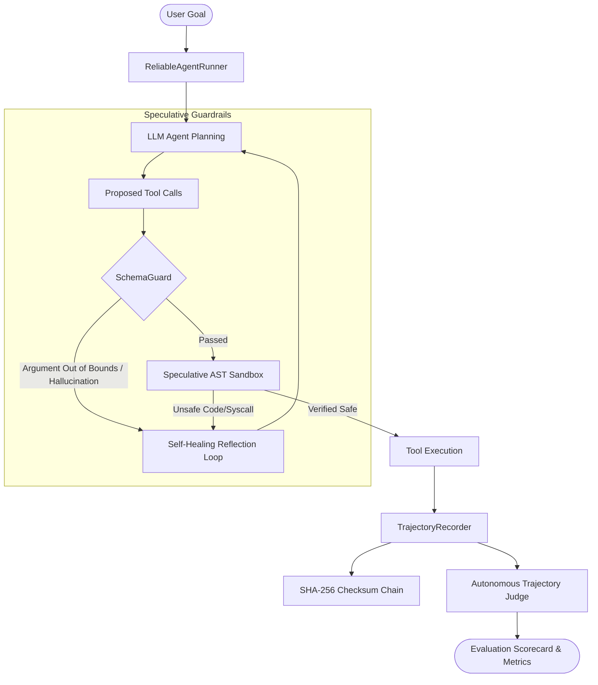

# Agentic Reliability Engine

[](https://opensource.org/licenses/MIT)
[](https://www.python.org/)
[](https://docs.pydantic.dev/)

**Agentic Reliability Engine** is a production-grade framework designed to tackle non-determinism, catch hallucinated tool invocations, and enforce self-healing execution loops for Autonomous LLM Agents.

---

## 📌 Architecture Overview



---

## 🚀 Core Features

### 1. Deterministic Trajectory Tracing & Replay
* Event-sourced trajectory recording of all agent thoughts, tool invocations, and state checkpoints.
* **Cryptographic SHA-256 Checksum Chains** prevent tampering and guarantee 100% reproducible debugging across production and staging environments.

### 2. Speculative Tool Verification (Pre-Flight Sandbox)
* Pre-execution validation of tool parameter boundaries, types, and allowed schemas.
* **Catches Hallucinated Parameters** before any API request or database mutation occurs.
* **AST Code Sandbox**: Static syntax and import analysis preventing dangerous system-level executions (`os.system`, `subprocess`, `open`).

### 3. Self-Healing Error Reflection
* Intercepts runtime tool exceptions and generates minimal-context advisory prompts.
* Guides LLMs to autonomously diagnose error signatures and self-correct without crashing the session.

### 4. Autonomous Trajectory Evaluation Suite
* Computes industry-standard agent evaluation metrics:
  * **Goal Completion Status (GCS)**
  * **Tool Redundancy Rate (TRR)**: Measures loop detection and wasted API calls.
  * **Argument Hallucination Rate (AHR)**
  * **Reliability Index**: Composite score (0-100) with letter grading (`A`, `B`, `C`, `D`, `F`).

---

## 📦 Quick Installation

```bash
git clone https://github.com/nhminhhh/agentic-reliability-engine.git
cd agentic-reliability-engine
pip install -e .
```

---

## 💡 Quickstart Example

```python
from agentic_reliability.core.types import StepType, ToolCall
from agentic_reliability.orchestrator.runner import ReliableAgentRunner
from agentic_reliability.orchestrator.tools import SafeMathTool, VectorRetrieverTool
from agentic_reliability.eval.judge import TrajectoryJudge

# 1. Initialize tools and runner
tools = [SafeMathTool(), VectorRetrieverTool()]
runner = ReliableAgentRunner(tools=tools)

# 2. Define an agent loop policy
def my_agent_policy(trajectory, feedback_prompt):
    if feedback_prompt:
        # Self-heal based on engine feedback
        return (StepType.FINAL_RESPONSE, "Healed answer", [])
    return (StepType.FINAL_RESPONSE, "Complete task", [])

# 3. Execute with reliability guardrails
trajectory = runner.run_agentic_loop(goal="Analyze data", agent_step_fn=my_agent_policy)

# 4. Evaluate with TrajectoryJudge
judge = TrajectoryJudge(verifier=runner.guard)
scorecard = judge.evaluate(trajectory)
print(f"Reliability Grade: {scorecard.grade} ({scorecard.reliability_index}/100)")
```

Run the built-in quickstart demo:
```bash
python examples/quickstart.py
```

---

## 🧪 Running Tests

```bash
pytest tests/ -v
```

---

## 📄 License
This project is licensed under the MIT License - see the LICENSE file for details.
